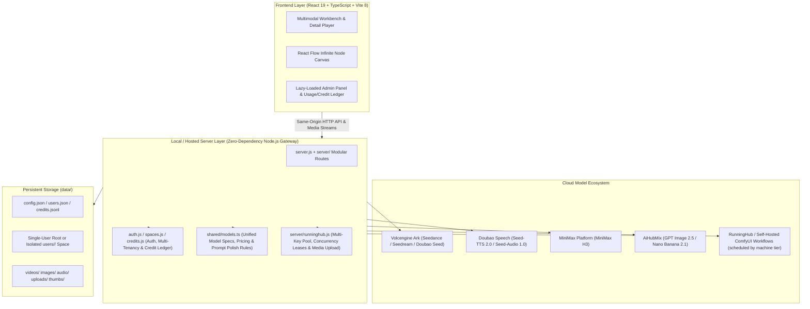

<div align="center">

<p align="center">
  <picture>
    <source media="(prefers-color-scheme: dark)" srcset="docs/screenshots/logo-dark.svg" />
    <source media="(prefers-color-scheme: light)" srcset="docs/screenshots/logo-light.svg" />
    
  </picture>
</p>

### A Local-First & Team-Ready Multimodal Generative AI Workbench
*Powered by Seedance 2.5/2.0, MiniMax H3, Seedream 5.0, GPT Image 2.5, Nano Banana 2.1, Doubao Speech & Infinite Node Canvas.*

[](LICENSE)
[](https://nodejs.org)
[](https://react.dev)
[](https://vitejs.dev)
[](https://reactflow.dev)

[English](README.md) | [简体中文](README.zh-CN.md)

[Features](#-features) • [Model Matrix](#-multi-platform--model-matrix) • [Quick Start](#-quick-start) • [Team Mode & Deployment](#-team-mode--deployment) • [Architecture & Storage](#-system-architecture--data-storage) • [Developer Guide](#-developer-guide)

</div>

---

> **Design Philosophy**: Workbench aesthetics inspired by Google Antigravity 2.0 and OpenAI Codex. **Native support for light and dark themes with automatic system-preference switching.** Clean sidebar navigation, a unified centered creation composer, low-contrast visual hierarchy, and system sans-serif typography keep the interface restrained and neutral so all visual focus stays on your generated content.

---

## 📸 Screenshots

> 🌗 **Adaptive Dual Theme**: The screenshots below automatically switch between light and dark modes based on your GitHub appearance settings.

<p align="center">
  <picture>
    <source media="(prefers-color-scheme: dark)" srcset="docs/screenshots/workbench-dark.png">
    <source media="(prefers-color-scheme: light)" srcset="docs/screenshots/workbench-light.png">
    
  </picture>
</p>
<p align="center"><em>Multimodal Creation Workbench: 5-in-1 composer for Video, Image, Speech, SFX, and Music alongside the recent generation feed</em></p>

<br />

<p align="center">
  <picture>
    <source media="(prefers-color-scheme: dark)" srcset="docs/screenshots/canvas-dark.png">
    <source media="(prefers-color-scheme: light)" srcset="docs/screenshots/canvas-light.png">
    
  </picture>
</p>
<p align="center"><em>Infinite Node Canvas (React Flow): Freeform topology across Text, Image, Video, and Audio nodes with @-mentions and reusable workflows</em></p>

---

## ✨ Features

### 1. 🌌 Infinite Node Canvas
- **Freeform Multimodal Topology**: Built on `@xyflow/react` with four native node types—**Text, Image, Video, and Audio**—allowing drag-and-connect pipelines to drive generation:
  - **Text ➔ Video / Image / Audio**: Pass text as generation prompts, or chain into downstream text nodes for expansion and refinement.
  - **Image ➔ Video**: Supply omni-reference images, start frames, or end frames.
  - **Image ➔ Image**: Multi-reference fusion and iterative image-to-image generation.
  - **Video / Audio ➔ Video**: Feed omni-reference assets (motion, camera work, pacing, or reference audio).
- **Prompt `@` Mentions & `/` Slash Presets**:
  - Type `@` in the canvas composer to insert connected upstream nodes (e.g., `@Image 1`, `@Text 1`) with inline highlighting; hover over reference chips to locate upstream nodes and edges bidirectionally.
  - Image nodes support `/` slash presets (multi-angle 3×3 grid, story progression 2×2 grid, character turnaround sheet, character design sheet, visual progression, cinematic lighting, and storyboard).
- **Video Continuation & Local Image Tools**:
  - **Video Nodes**: Extract the current frame, first frame, or last frame into a new image node with one click, or click "Continue Shot" to automatically grab the last frame and chain a new video node.
  - **Image Nodes**: Built-in interactive freeform/aspect-locked cropping, 2×2 / 3×3 / 4×4 grid slicing (ideal for splitting multi-shot grids), and aspect-ratio AI outpainting.
- **Group Execution, Workflows & Stack Organization**:
  - Box-select batch actions (batch generate, align/distribute, group `⌘G`, stack/collapse, and cross-canvas copy & paste);
  - Execute an entire group in topological order from upstream to downstream, or save a group as a reusable workflow across projects;
  - Four-color node tags with top-bar quick jump, automatic topological layout, and magnetic alignment guides.

### 2. 🎥 Multimodal Workbench
- **Cinematic Video Generation (Video)**:
  - **Seedance 2.5 / 2.0 / 2.0 Fast / 2.0 Mini** (Volcengine Ark): Supports text-to-video, first/last frame control, and omni-reference inputs (mix up to 9 images + 3 videos + 3 local audio clips). Seedance 2.5 supports up to 30-second clips; 2.0 supports up to 4K resolution.
  - **MiniMax H3 / H3 Max** (MiniMax Platform): Supports 480P / 768P / 2K video generation, first/last frame control, and omni-reference inputs.
- **Professional Image Generation (Image)**:
  - **Seedream 5.0 Pro / Flash / Standard** (Volcengine Ark): Supports 1K / 1.5K / 2K / 3K / 4K resolution tiers and up to 14 reference images.
  - **GPT Image 2.5 (Sunburst / Flare)** & **Nano Banana 2.1** (AiHubMix): Supports up to 4K resolution, multiple quality tiers, and up to 16 reference images.
- **End-to-End Audio Generation (Speech, SFX & Music)**:
  - **Natural Text-to-Speech (TTS)**: Powered by Doubao Speech Synthesis 2.0 (`Seed-TTS 2.0`), with built-in Chinese, English, and multilingual voice filtering and instant preview.
  - **Sound Effects (SFX)** & **AI Soundtrack (Music)**: Powered by Doubao Audio Generation 1.0 (`Seed-Audio 1.0`), supporting text-to-SFX or uploading a video to automatically score and preview synchronized audio-video playback.

### 3. 🎭 Character Library & Prompt Skills
- **Character Consistency Profiles**: Persistently store character names, appearance descriptions, and up to 6 reference images; inject references and traits into any prompt with a single click for multi-shot consistency.
- **Prompt Skills Library**: Ships with official skills ("Multi-Shot Sequence", "Character Concept Sheet", "Storyboard First Frame", etc.) plus custom skill creation and tag filtering.
- **Model-Adaptive Prompt Polish**: Powered by `Doubao Seed 2.1`, tailoring prompt rewrites to the active model's conventions (Seedance 2.5 timestamped shot breakdown, Seedance 2.0 camera & audio cues, Seedream image-to-image directives, TTS phrasing rules, and SFX/music descriptors) with one-click undo.

### 4. 👥 Local-First & Team Hosted Modes
- **Local Mode (Default)**: Zero external runtime dependencies and no login required. All configuration, generation history, and media assets are stored 100% locally in the `data/` directory.
- **Team Mode**: Creating user accounts via the CLI automatically enables authentication and multi-tenant workspace isolation:
  - **Data Isolation**: Each member's generation history, canvases, characters, skills, and media files are stored in isolated per-user spaces.
  - **Credit Accounting**: `1 credit = ¥0.01 CNY` (mapped 1:1 to official list prices). Credits are pre-authorized on submission, reconciled against actual token/second usage upon completion, and automatically refunded in full on failure.
  - **Role Separation**: "Settings" and "Admin" are strictly separated—API keys, third-party provider balances (Volcengine / MiniMax / AiHubMix), raw upstream errors, and member credit management are visible only to administrators.

---

## ⚖️ Multi-Platform & Model Matrix

Innate Studio centers on **Volcengine** while integrating **MiniMax** and **AiHubMix**. Provider API keys can be configured independently in the bottom-left **Admin** panel (or via environment variables)—enable whichever providers you need:

| Provider | Config Key / Env Variable | Capabilities | Supported Models |
| :--- | :--- | :--- | :--- |
| **Volcengine Ark** | `ARK_API_KEY` | Video generation, image generation, prompt polishing, canvas text nodes | `Seedance 2.5`, `Seedance 2.0 / Fast / Mini`<br>`Seedream 5.0 Pro / Flash / 5.0`<br>`Seed 2.1 Lite / Turbo / Pro` |
| **Doubao Speech** | `DOUBAO_SPEECH_API_KEY` | Text-to-Speech (TTS), Sound Effects (SFX), Video Music (Music) | `Seed-TTS 2.0`<br>`Seed-Audio 1.0` |
| **MiniMax** | `MINIMAX_CN_API_KEY` | Video generation (T2V, first/last frame, omni-reference) | `MiniMax H3`, `MiniMax H3 Max` |
| **AiHubMix** | `AIHUBMIX_API_KEY`<br>`AIHUBMIX_MANAGE_KEY` *(balance)* | Image generation (T2I, multi-image reference), account balance | `GPT Image 2.5 Sunburst`<br>`GPT Image 2.5 Flare`<br>`Nano Banana 2.1` |
| **Volcengine Billing** | `VOLC_ACCESS_KEY_ID`<br>`VOLC_SECRET_ACCESS_KEY` | Real-time Volcengine account balance query | — |
| **RunningHub** | `RUNNINGHUB_KEYS_FILE`<br>`RUNNINGHUB_API_KEY` *(single key)* | Cloud ComfyUI workflows (image-to-video, character swap, …) | Driven by the registry — see [workflow platform docs](docs/runninghub-workflows.md) |

### 🧩 Workflow Platforms (RunningHub / AutoDL ComfyUI)

Beyond the built-in models, the app can drive **self-hosted or cloud ComfyUI workflows**. Each workflow's input slots are compiled into the exact same `input_rules` shape used by built-in models, so canvas nodes, the composer, quoting, credit holds and settlement all reuse one code path — the frontend needs no per-workflow code.

Onboarding is deliberately **per-workflow, not generic**: the ComfyUI HTTP API can only change node field values and cannot add/remove nodes or rewire edges, so requests like "only accept two reference images" are met by slot definitions plus a fill policy inside the registry, not by editing the workflow. Adding a workflow means appending one entry to `RH_WORKFLOWS` in `shared/runninghub.ts` (node ids, field names, parameter ranges, machine tiers, estimate) — see [docs/runninghub-workflows.md](docs/runninghub-workflows.md).

- **Machine tiers**: RunningHub offers `default` (24G) / `plus` (48G) / `ultra` (84G). Declaring tiers in the registry surfaces a dropdown in both canvas nodes and the composer; a mismatched tier is rejected by the platform (error 435), so the registry must match the real workflow.
- **China and international sites**: the platform runs as two independent sites — `runninghub.cn` and `runninghub.ai` — with separate accounts, keys, workflow IDs, and media libraries. Every key declares its origin with a `site` field (enum `cn` / `ai`), and all requests (submit, media upload, task polling) go to that host; workflow IDs can be configured per site, and scheduling only picks keys whose site has an ID for the requested workflow.
- **Multi-key pool & concurrency routing**: keys are read from a JSON file referenced by an env variable (raw JSON text or a single key also work), supporting `["k1","k2"]`, `[{title,key,site,concurrency}]`, and so on; untitled keys get numbered names and keys without `site` fall back to `RUNNINGHUB_SITE` (China site by default). Each key defaults to concurrency 1; when the current key is saturated the pool rotates to the next one, and when all are saturated it waits (15s by default) before reporting busy. On restart, key ownership and site recorded in history restore the leases so concurrency is never under-counted. The account-status endpoint also returns each key's remaining RH coins: the admin panel shows them per key, and scheduling prefers keys with more coins so balances converge (`RUNNINGHUB_ROUTE_BY_COINS=0` disables this and restores plain round-robin).
- **Key protection**: the admin panel only renders a key's title, its first/last 4 characters, its site, its occupancy, and its remaining coins. Full keys never appear in any API response, and a key's identity hash is derived from its value so renaming never reshuffles leases.
- **Billing**: uses the platform-reported `usage.consumeMoney` when present, otherwise the registry's `estimate` (per machine tier).

---

## 🚀 Quick Start

### Prerequisites
- **Node.js**: `>= 22.18` (the server runs the shared TypeScript model definitions `shared/models.ts` directly via native Node.js TypeScript support)
- **pnpm**: `>= 10` (the project pins pnpm 11; pnpm shares a content-addressable store to save disk space)

### Installation & Launch (Local Mode)

```bash
# 1. Clone the repository
git clone https://github.com/realruian/innate-studio.git
cd innate-studio

# 2. Install dependencies, build the frontend, and start the server
pnpm install
pnpm start
```

Once started, open **`http://127.0.0.1:5178`** in your browser. Click **Admin** in the bottom-left corner to configure your provider API keys.

> 💡 **Environment Variable Injection (Stateless Keys)**: If you prefer not to persist API keys in `data/config.json`, pass them via environment variables at launch:
> ```bash
> ARK_API_KEY=... DOUBAO_SPEECH_API_KEY=... MINIMAX_CN_API_KEY=... AIHUBMIX_API_KEY=... pnpm start
> ```
> To customize the listening port or data directory:
> ```bash
> PORT=5180 INNATE_DATA_DIR=/path/to/data pnpm start
> ```

#### Local-first media and public storage

Media stays in local `data/uploads/` by default. It is uploaded to public storage only when a generation API requires a public URL or when you explicitly publish it from the media library. Valid public links are cached in `data/publications.json` and reused instead of uploading again.

- **Volcengine TOS**: set `INNATE_STUDIO_VOLC_TOS_ACCESS_KEY_ID`, `INNATE_STUDIO_VOLC_TOS_ACCESS_KEY`, `INNATE_STUDIO_VOLC_TOS_BUCKET`, and `INNATE_STUDIO_VOLC_TOS_PATH`. The bucket must already exist; the app validates it and never creates it. The prefix is marked with `.keep`. TOS can also be configured under **Admin → Volcengine TOS**.
- Ark reference videos require a directly readable media URL, and sharing local media needs a public link; both use TOS object URLs. Objects are uploaded with the `public-read` ACL, so the bucket must allow public reads or be bound to a publicly accessible custom domain.

---

## 👥 Team Mode & Deployment

When at least one user account exists in the data directory, the server automatically switches from **Local Mode** to **Team Mode**, requiring authentication to access the workbench.

### Account & Credit Management CLI (`pnpm user`)

> ⚠️ **Note**: Stop the running server before modifying accounts via `pnpm user`, or ensure account state stays synchronized. The initial administrator account must be created via the CLI.

```bash
# Create the first admin account and migrate existing local-mode data to this user
pnpm user add alice --admin --with-local-data

# Create a regular member account (specify a password, or omit to generate a one-time initial password)
pnpm user add bob --password <password>

# Grant credits to a member (100 credits = 1 CNY; negative values deduct credits)
pnpm user grant bob 5000

# Reset a member's password
pnpm user reset bob

# List all accounts, statuses, and credit balances
pnpm user list

# Issue an agent token (read = observe only, write = can generate), list and revoke
pnpm user token add --scope read
pnpm user token list
pnpm user token revoke <id>
```

Once logged in, administrators can also create members, grant credits, reset passwords, or deactivate accounts directly from **Admin ➔ Members** in the bottom-left corner, as well as inspect total team credits and monthly usage.

### Production Server Deployment (`deploy/`)

Ready-to-use production configuration templates are provided under `deploy/`:
- [`deploy/env.example`](deploy/env.example): Environment variable template for server secrets (recommended at `/etc/innate-studio.env` with `chmod 600`).
- [`deploy/innate-studio.service`](deploy/innate-studio.service): `systemd` service unit with least-privilege sandboxing (`ProtectSystem=strict`, etc.).
- [`deploy/Caddyfile`](deploy/Caddyfile): Caddy reverse proxy and automatic HTTPS configuration (forwards to `127.0.0.1:5178` with a 70MB request body limit to support 64MB reference uploads).

---

## 🧱 System Architecture & Data Storage

### Architecture Overview



### Data Directory Layout (`data/`)

All application state is persisted inside `data/` (customizable via `INNATE_DATA_DIR`):

| File / Directory | Description |
| :--- | :--- |
| `data/config.json` | Provider API keys and billing configuration (environment variables take precedence) |
| `data/users.json` / `sessions.json` | Team-mode user accounts (salted `scrypt` password hashes) and active login sessions |
| `data/credits.jsonl` | Append-only credit transaction ledger (grants, pre-authorizations, settlements, refunds) |
| `data/users/<id>/` | Per-member isolated workspace in Team Mode (mirrors the single-user layout below) |
| `data/history.json` | Generation task history, parameters, token/credit usage, and status records |
| `data/canvases.json` | Infinite canvas projects (node topology, edges, groups, stacks, and viewport state) |
| `data/workflows.json` | Reusable node workflow templates saved from the canvas |
| `data/characters.json` | Character library profiles (names, appearance traits, and linked reference images) |
| `data/skills.json` | User-defined custom prompt engineering skills |
| `data/videos/` `images/` `audio/` | Automatically persisted video, image, and audio outputs |
| `data/uploads/` `thumbs/` | User-uploaded reference assets and automatically generated list thumbnails |

> RunningHub key files deliberately live **outside** `data/`: point `RUNNINGHUB_KEYS_FILE` at any path (or inject JSON via `RUNNINGHUB_KEYS`, or a single key via `RUNNINGHUB_API_KEY`) so container deployments can mount it as a secret and keep it out of data backups.

---

## 🛠️ Developer Guide

### Common Commands

```bash
# Start Vite frontend HMR dev server (proxies API requests to 127.0.0.1:5178)
pnpm dev

# Run TypeScript type checking only
pnpm typecheck

# Run the full automated test suite (typecheck, model & billing unit tests, canvas logic, API & team mode tests, CSS lint)
pnpm test

# Start a standalone mock environment on port 5179 (no real API keys or token spend required)
pnpm dev:mock

# Run the automated light/dark full-page UI walkthrough script
pnpm walkthrough
```

### Visual Walkthrough & Design System
This project follows strict UI and interaction guidelines (color tokens, 6-step type scale, spacing scale, and custom-drawn native-free controls). Please read **[DESIGN.md](DESIGN.md)** before modifying UI components or styles, and ensure `pnpm test` passes before committing.

---

## 🤖 Agent / Skills 接入

本机已暴露一套 JSON 接口，可被 Codex、Claude Code 等编程客户端通过 **Agent Skills** 直接调用——无需 MCP。技能说明在 [`.claude/skills/innate-studio/SKILL.md`](.claude/skills/innate-studio/SKILL.md)，并已软链到 `.agents/skills/` 供 Codex 读取。

**首选用自带 CLI**（`cli/innate.mjs`，零依赖）。它会被装成一个全局命令 `innate`——装完之后在任何目录直接敲就行，**不需要 pnpm，也不需要站在项目目录里**：

```bash
node cli/install.mjs          # 只需一次；--dir <目录> 指定位置，--uninstall 卸载
innate --help
```

接入三步：

1. **建令牌**：在「设置 → Agent Keys」创建（本机模式、多人模式都能在界面上建），也可以用命令行 `pnpm user token add --scope read|write`。令牌形如 `isk_…`，多人模式下绑定到你的账号（空间隔离、积分、角色全部继承），本机模式挂「本地 Agent」身份。`scope read` 的令牌只能读（生成/上传/删除返回 403 `read_only_key`，只有等任务结果的 `wait` 放行），要花钱的操作就用 `write`。
2. **记住一次**：`innate config set --key isk_…`（写入 `~/.innate/config.json`，权限 600）。服务地址会自动发现（服务启动时把监听地址写进数据目录的 `server.json`），改了 `PORT` 不用另外配置；临时覆盖用 `--api-url` 或环境变量。本机模式不需要令牌；多人模式不带令牌会落到本机那份数据上。
3. **调用与拿结果**：例如 `innate generate image --model doubao-seedream-5-0-pro-260628 --prompt "猫" --wait`、`innate canvas grid --ids r1,r2,r3 --cols 3`（一条命令完成建画布 + 网格精确摆放）、`innate workflow save --canvas <画布id> --name 分镜模板`（整张画布存成可复用工作流）、`innate flow list`（AutoDL.art 平台工作流）。模型 id 一律以 `innate models` 打出来的为准。`--wait` 会调 `POST /api/history/<id>/refresh?wait=60` 阻塞等到完成，返回里的 `localPath` 是结果在本机的绝对路径，同一台机器可直接读取。

连不上时先跑 `innate doctor`，它会报出服务地址、连通性、身份和下一步该做什么。

详见技能文件中的命令清单、无限画布节点坐标写法与最小闭环示例。

## 📄 License & Acknowledgements

- Core source code is licensed under the [MIT License](LICENSE).
- Icons are provided by [Hugeicons](https://hugeicons.com/) (MIT License) and [Lucide](https://lucide.dev/) (ISC License), and the node canvas is built on [React Flow](https://reactflow.dev/) (MIT License). See [THIRD-PARTY-NOTICES.md](THIRD-PARTY-NOTICES.md) for details.
